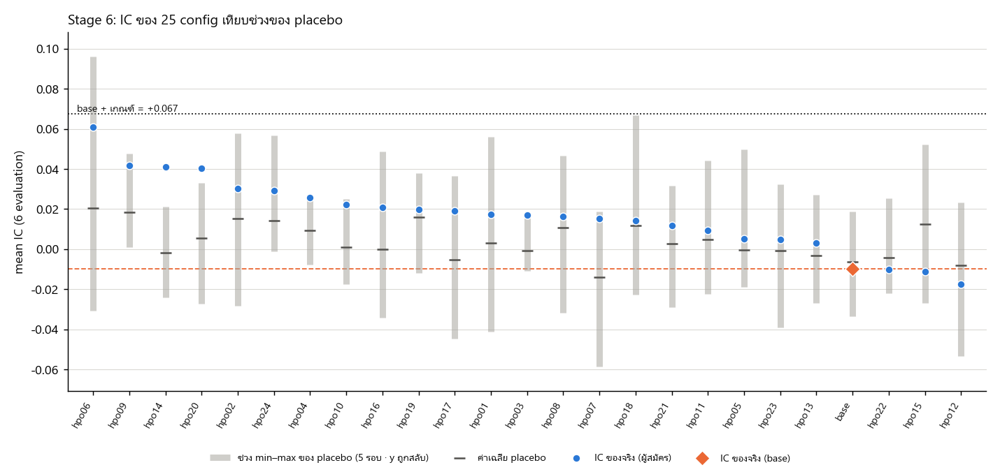

# Stage 6 — HPO ของ track 1 (DECISIONS B38)

> สร้างเมื่อ 2026-10-24 01:31 · ผลทุกตัวเป็น development / walk-forward (dev ≤ 2025-02-25) · track 1 เท่านั้น (CNN→ANN spectrogram อย่างเดียว) · 25 config × 6 evaluation × seeds (0, 1, 2) · placebo 5 รอบ (seed 100–104)

## สรุป: **ไม่มีผู้ชนะ**

- ผู้สมัครอันดับ 1 (mean IC สูงสุดใน 24 ผู้สมัคร): **hpo06** · mean IC +0.0607 · base -0.0096
- เกณฑ์สุดท้ายของข้อ (1) = max(noise ของ seed 0.0185, B22 0.0597, T_hpo +0.0770) = **0.0770**
- อัตราผลบวกปลอมของเกณฑ์ T_hpo (max ของ 5 รอบ) ≈ 1/6
- กติกา B39: คำทำนายคงที่ (std(ŷ)/std(y) < 1e-8 หรือ ptp(ŷ) = 0) → IC := 0 ทั้งระดับ seed และ evaluation ในทุกส่วน (รายละเอียดข้อ 7) · เกณฑ์ A6 (2) เป็นเกณฑ์บังคับ

## 1. ตาราง config ทั้งหมด (เรียงตาม mean IC)

| # | config | lr | batch | dropout | wd | filters | hidden | nperseg | hop | noise | ภาพ | พารามิเตอร์ | mean IC | ΔIC | σ seed | Spearman | IC>0 | relMAE (return) | relMAE (บาท) | หลังปรับ c (return) | หลังปรับ c (บาท) | StdRatio | DirAcc | ชนเพดาน epoch (จริง) | ชนเพดาน (placebo) |
|---|---|---|---|---|---|---|---|---|---|---|---|---|---|---|---|---|---|---|---|---|---|---|---|---|---|
| 1 | hpo06 | 0.001 | 32 | 0.0 | 0.01 | 4-8 | 32 | 8 | 4 | 0.1 | 1x5x33 | 1,977 | +0.0607 | +0.0703 | 0.0269 | +0.0492 | 6/6 | 1.0084 | 1.0085 | 1.0031 | 1.0033 | 0.046 | 0.496 | 0/18 | 0/90 |
| 2 | hpo09 | 0.0003 | 16 | 0.3 | 0.0001 | 8-16 | 64 | 32 | 2 | 0.5 | 1x17x65 | 18,849 | +0.0419 | +0.0515 | 0.0299 | +0.0258 | 5/6 | 1.0042 | 1.0041 | 1.0002 | 1.0002 | 0.021 | 0.516 | 0/18 | 0/90 |
| 3 | hpo14 | 0.003 | 16 | 0.0 | 0.01 | 4-8 | 32 | 32 | 1 | 0.3 | 1x17x129 | 17,337 | +0.0412 | +0.0508 | 0.0182 | +0.0305 | 4/6 | 1.0059 | 1.0057 | 1.0011 | 1.0010 | 0.005 | 0.495 | 0/18 | 0/90 |
| 4 | hpo20 | 0.003 | 64 | 0.5 | 0.0001 | 8-16 | 32 | 8 | 2 | 0.1 | 1x5x65 | 5,985 | +0.0403 | +0.0499 | 0.0163 | -0.0026 | 5/6 | 1.0078 | 1.0077 | 1.0002 | 1.0002 | 0.022 | 0.497 | 0/18 | 0/90 |
| 5 | hpo02 | 0.001 | 16 | 0.3 | 0.01 | 4-8 | 32 | 8 | 4 | 0.3 | 1x5x33 | 1,977 | +0.0304 | +0.0400 | 0.0276 | +0.0421 | 4/6 | 1.0078 | 1.0079 | 1.0033 | 1.0033 | 0.034 | 0.506 | 0/18 | 0/90 |
| 6 | hpo24 | 0.001 | 64 | 0.0 | 0.001 | 8-16 | 64 | 32 | 2 | 0.3 | 1x17x65 | 18,849 | +0.0294 | +0.0390 | 0.0156 | +0.0120 | 4/6 | 1.0060 | 1.0059 | 1.0018 | 1.0018 | 0.025 | 0.511 | 0/18 | 0/90 |
| 7 | hpo04 | 0.003 | 16 | 0.5 | 0.01 | 16-32 | 16 | 8 | 1 | 0.0 | 1x5x129 | 21,585 | +0.0257 | +0.0353 | 0.0091 | +0.0255 | 3/6 | 1.0052 | 1.0051 | 1.0003 | 1.0003 | 0.004 | 0.496 | 0/18 | 0/90 |
| 8 | hpo10 | 0.001 | 16 | 0.0 | 0.01 | 4-8 | 16 | 16 | 4 | 0.1 | 1x9x33 | 2,713 | +0.0224 | +0.0320 | 0.0158 | +0.0102 | 4/6 | 1.0063 | 1.0062 | 1.0015 | 1.0013 | 0.035 | 0.500 | 0/18 | 0/90 |
| 9 | hpo16 | 0.003 | 64 | 0.3 | 0.0001 | 4-8 | 32 | 8 | 2 | 0.0 | 1x5x65 | 3,001 | +0.0208 | +0.0304 | 0.0322 | +0.0001 | 3/6 | 1.0044 | 1.0044 | 1.0002 | 1.0003 | 0.033 | 0.499 | 0/18 | 0/90 |
| 10 | hpo19 | 0.003 | 32 | 0.0 | 0.001 | 16-32 | 16 | 8 | 2 | 0.0 | 1x5x65 | 13,393 | +0.0199 | +0.0295 | 0.0301 | -0.0046 | 4/6 | 1.0073 | 1.0072 | 1.0007 | 1.0008 | 0.035 | 0.506 | 0/18 | 0/90 |
| 11 | hpo17 | 0.001 | 64 | 0.5 | 0.001 | 8-16 | 32 | 16 | 2 | 0.3 | 1x9x65 | 10,081 | +0.0190 | +0.0286 | 0.0103 | -0.0046 | 4/6 | 1.0125 | 1.0124 | 1.0052 | 1.0052 | 0.044 | 0.498 | 0/18 | 0/90 |
| 12 | hpo01 | 0.001 | 32 | 0.3 | 0.001 | 8-16 | 16 | 32 | 1 | 0.1 | 1x17x129 | 34,369 | +0.0174 | +0.0270 | 0.0075 | +0.0018 | 3/6 | 1.0070 | 1.0068 | 1.0010 | 1.0010 | 0.034 | 0.517 | 0/18 | 0/90 |
| 13 | hpo03 | 0.001 | 64 | 0.3 | 0.01 | 4-8 | 16 | 8 | 2 | 0.1 | 1x5x65 | 2,713 | +0.0171 | +0.0267 | 0.0182 | +0.0051 | 3/6 | 1.0086 | 1.0087 | 1.0026 | 1.0027 | 0.046 | 0.520 | 0/18 | 0/90 |
| 14 | hpo08 | 0.0003 | 64 | 0.5 | 0.0001 | 8-16 | 32 | 32 | 4 | 0.0 | 1x17x33 | 10,081 | +0.0164 | +0.0261 | 0.0192 | +0.0050 | 5/6 | 1.0074 | 1.0071 | 1.0025 | 1.0022 | 0.043 | 0.498 | 0/18 | 0/90 |
| 15 | hpo07 | 0.0003 | 16 | 0.3 | 0.001 | 4-8 | 64 | 16 | 4 | 0.5 | 1x9x33 | 3,577 | +0.0154 | +0.0250 | 0.0061 | +0.0059 | 3/6 | 1.0068 | 1.0068 | 1.0019 | 1.0019 | 0.029 | 0.504 | 0/18 | 0/90 |
| 16 | hpo18 | 0.0003 | 16 | 0.0 | 0.001 | 16-32 | 64 | 16 | 4 | 0.3 | 1x9x33 | 14,257 | +0.0143 | +0.0239 | 0.0076 | +0.0145 | 3/6 | 1.0082 | 1.0081 | 1.0031 | 1.0030 | 0.040 | 0.509 | 0/18 | 0/90 |
| 17 | hpo21 | 0.003 | 64 | 0.5 | 0.01 | 16-32 | 64 | 32 | 1 | 0.5 | 1x17x129 | 71,601 | +0.0120 | +0.0216 | 0.0122 | +0.0023 | 3/6 | 1.0052 | 1.0050 | 1.0006 | 1.0005 | 0.003 | 0.497 | 0/18 | 0/90 |
| 18 | hpo11 | 0.0003 | 16 | 0.5 | 0.01 | 16-32 | 64 | 32 | 4 | 0.0 | 1x17x33 | 22,449 | +0.0094 | +0.0190 | 0.0148 | +0.0090 | 4/6 | 1.0077 | 1.0075 | 1.0047 | 1.0047 | 0.032 | 0.497 | 0/18 | 0/90 |
| 19 | hpo05 | 0.0003 | 32 | 0.0 | 0.0001 | 16-32 | 16 | 16 | 1 | 0.5 | 1x9x129 | 37,969 | +0.0051 | +0.0147 | 0.0091 | +0.0003 | 5/6 | 1.0089 | 1.0090 | 1.0023 | 1.0023 | 0.048 | 0.520 | 0/18 | 0/90 |
| 20 | hpo23 | 0.0003 | 32 | 0.5 | 0.0001 | 8-16 | 32 | 32 | 1 | 0.1 | 1x17x129 | 34,657 | +0.0047 | +0.0144 | 0.0163 | -0.0070 | 2/6 | 1.0043 | 1.0042 | 1.0015 | 1.0014 | 0.022 | 0.505 | 0/18 | 0/90 |
| 21 | hpo13 | 0.001 | 32 | 0.5 | 0.001 | 8-16 | 16 | 16 | 1 | 0.3 | 1x9x129 | 17,985 | +0.0031 | +0.0127 | 0.0033 | -0.0136 | 3/6 | 1.0048 | 1.0047 | 1.0011 | 1.0012 | 0.020 | 0.494 | 0/18 | 0/90 |
| 22 | base | 0.001 | 32 | 0.3 | 0.001 | 8-16 | 32 | 16 | 2 | 0.3 | 1x9x65 | 10,081 | -0.0096 | — | 0.0076 | -0.0267 | 2/6 | 1.0120 | 1.0118 | 1.0050 | 1.0049 | 0.045 | 0.486 | 0/18 | 0/90 |
| 23 | hpo22 | 0.003 | 32 | 0.3 | 0.0001 | 16-32 | 16 | 16 | 1 | 0.5 | 1x9x129 | 37,969 | -0.0103 | -0.0007 | 0.0137 | -0.0083 | 2/6 | 1.0051 | 1.0052 | 1.0012 | 1.0012 | 0.021 | 0.509 | 0/18 | 0/90 |
| 24 | hpo15 | 0.003 | 32 | 0.3 | 0.0001 | 4-8 | 64 | 8 | 4 | 0.0 | 1x5x33 | 2,553 | -0.0111 | -0.0015 | 0.0202 | -0.0165 | 3/6 | 1.0084 | 1.0083 | 1.0018 | 1.0018 | 0.027 | 0.487 | 0/18 | 0/90 |
| 25 | hpo12 | 0.0003 | 64 | 0.0 | 0.001 | 16-32 | 64 | 16 | 2 | 0.5 | 1x9x65 | 22,449 | -0.0172 | -0.0076 | 0.0274 | -0.0379 | 2/6 | 1.0076 | 1.0075 | 1.0011 | 1.0011 | 0.026 | 0.498 | 0/18 | 0/90 |

σ seed = std ข้าม seed ของ IC เฉลี่ย 6 evaluation (B17) · ชนเพดาน epoch = จำนวน run (หนึ่ง unit × หนึ่ง seed) ที่หยุดเพราะครบ 200 epoch ไม่ใช่ early stopping · หลังปรับ c = หลังปรับขนาดคำทำนายด้วย c ที่เลือกจากส่วน early-stop (B18 · รายงานเพิ่ม ไม่ใช้เลือก)

## 2. placebo ของการค้นหาทั้งชุด (y ใน train ถูกสลับ · y ของ test เป็นของจริง)

| รอบ (seed สลับ) | IC ของ base | ผู้สมัครที่ IC สูงสุด | IC สูงสุด | T_s = max(IC − IC_base) |
|---|---|---|---|---|
| 100 | +0.0189 | hpo06 | +0.0959 | +0.0770 |
| 101 | -0.0334 | hpo04 | +0.0144 | +0.0478 |
| 102 | -0.0085 | hpo15 | +0.0451 | +0.0536 |
| 103 | -0.0067 | hpo18 | +0.0336 | +0.0403 |
| 104 | -0.0011 | hpo08 | +0.0466 | +0.0478 |

- **T_hpo = max ข้ามรอบของ T_s = +0.0770** · noise ของ seed (pooled 25 config) = 0.0185 · B22 = 0.0597
- **เกณฑ์สุดท้ายของ A6 ข้อ (1) = max(0.0185, 0.0597, +0.0770) = 0.0770**

## 3. ตรวจผู้ชนะทีละข้อ (A6 · ตรวจเฉพาะอันดับ 1 · ไม่ไล่อันดับ 2, 3)

| ข้อ | ค่า | ผล |
|---|---|---|
| (1) ΔIC เทียบ base > max(noise, 0.0597, T_hpo) | ΔIC +0.0703 vs 0.0770 | ไม่ผ่าน |
| (2) **[บังคับ]** ยืนยัน seeds 10–12: ΔIC > เกณฑ์ข้อ (1) | ΔIC -0.0462 vs 0.0770 | ไม่ผ่าน |
| (3) IC>0 ≥ 5/6 evaluation · ตัด evaluation ที่ ΔIC สูงสุด (ADVANC-2) แล้ว ΔIC เฉลี่ย > max(noise, 0.0597) | IC>0 6/6 · ΔIC เฉลี่ยที่เหลือ +0.0491 vs 0.0597 | ไม่ผ่าน |
| (4) relMAE (return · ก่อนปรับขนาด) ไม่สูงกว่า base | 1.0084 vs base 1.0120 | **ผ่าน** |

→ **ไม่มีผู้ชนะ**

ข้อมูลเสริม (ไม่ใช้ตัดสิน): ข้อ (3) คิดซ้ำจากผลยืนยัน seeds 10–12 → IC>0 3/6 · ΔIC เฉลี่ยหลังตัด -0.0631

## 4. (descriptive เท่านั้น) mean IC เฉลี่ยตามระดับของแต่ละพารามิเตอร์ · ห้ามใช้เลือก config

| param | level | n_config | mean IC (จริง) | mean IC (placebo เฉลี่ย) | placebo min–max ข้ามรอบ |
|---|---|---|---|---|---|
| lr | 0.0003 | 8 | +0.0113 | +0.0028 | -0.0211 … +0.0386 |
| lr | 0.001 | 8 | +0.0249 | +0.0057 | -0.0226 … +0.0458 |
| lr | 0.003 | 8 | +0.0173 | +0.0050 | -0.0151 … +0.0202 |
| batch | 16 | 8 | +0.0251 | +0.0056 | -0.0164 … +0.0300 |
| batch | 32 | 8 | +0.0112 | +0.0055 | -0.0271 … +0.0425 |
| batch | 64 | 8 | +0.0172 | +0.0023 | -0.0154 … +0.0322 |
| dropout | 0.0 | 8 | +0.0220 | +0.0067 | -0.0132 … +0.0428 |
| dropout | 0.3 | 8 | +0.0152 | +0.0038 | -0.0276 … +0.0379 |
| dropout | 0.5 | 8 | +0.0163 | +0.0030 | -0.0182 … +0.0239 |
| weight_decay | 0.0001 | 8 | +0.0135 | +0.0052 | -0.0222 … +0.0366 |
| weight_decay | 0.001 | 8 | +0.0126 | +0.0018 | -0.0244 … +0.0404 |
| weight_decay | 0.01 | 8 | +0.0274 | +0.0064 | -0.0123 … +0.0276 |
| filters | 4-8 | 8 | +0.0246 | +0.0041 | -0.0275 … +0.0380 |
| filters | 8-16 | 8 | +0.0215 | +0.0054 | -0.0224 … +0.0394 |
| filters | 16-32 | 8 | +0.0074 | +0.0040 | -0.0089 … +0.0272 |
| ann_hidden | 16 | 8 | +0.0125 | +0.0027 | -0.0155 … +0.0254 |
| ann_hidden | 32 | 8 | +0.0292 | +0.0056 | -0.0297 … +0.0404 |
| ann_hidden | 64 | 8 | +0.0118 | +0.0053 | -0.0137 … +0.0388 |
| nperseg | 8 | 8 | +0.0255 | +0.0098 | -0.0194 … +0.0420 |
| nperseg | 16 | 8 | +0.0065 | -0.0028 | -0.0249 … +0.0305 |
| nperseg | 32 | 8 | +0.0216 | +0.0065 | -0.0146 … +0.0321 |
| hop | 1 | 8 | +0.0124 | +0.0006 | -0.0184 … +0.0175 |
| hop | 2 | 8 | +0.0214 | +0.0050 | -0.0167 … +0.0378 |
| hop | 4 | 8 | +0.0197 | +0.0078 | -0.0238 … +0.0493 |
| noise_std | 0.0 | 6 | +0.0135 | +0.0088 | -0.0152 … +0.0359 |
| noise_std | 0.1 | 6 | +0.0271 | +0.0049 | -0.0259 … +0.0399 |
| noise_std | 0.3 | 6 | +0.0229 | +0.0052 | -0.0202 … +0.0397 |
| noise_std | 0.5 | 6 | +0.0078 | -0.0009 | -0.0172 … +0.0239 |

เฉลี่ยจาก 24 ผู้สมัคร (ไม่นับ base) · การออกแบบสมดุลทำให้แต่ละระดับมี 8 config (noise_std 6 config) แต่ปัจจัยอื่นยังปนกันอยู่ จึงใช้เป็นภาพรวมเท่านั้น

## 5. จำนวน config และเวลา

- config ที่ต่างกันทั้งหมดที่ลองใน dev ตาม experiment_log: **45** (แถวจาก Stage 6 = 24; เดิม 21 + ใหม่ 24 = 45 ถ้าครบ)
- เวลา (wall · jobs ตามที่รัน · ของครั้งนี้): ค้นหา 34.9 นาที · placebo 203.3 นาที · ยืนยัน 1.9 นาที
- ผลรวมเวลา train ของทุก unit (วินาที · จากคอลัมน์ seconds): ค้นหา 205 นาที · placebo 1215 นาที · ยืนยัน 10 นาที

## 6. รูป

## 7. Collapse — คำทำนายคงที่ (IC := 0 ตาม B39)

กติกา: std(ŷ)/std(y) < 1e-8 หรือ ptp(ŷ) = 0 → IC Pearson = IC Spearman := 0 · ใช้เหมือนกันทุกส่วน (ค้นหา · placebo · ยืนยัน) · seed-run = หนึ่ง unit × หนึ่ง seed เดี่ยว · evaluation = คำทำนายเฉลี่ย 3 seed ของหนึ่ง unit 

- ค้นหา: **41/450** seed-run · **3/150** evaluation
- placebo (5 รอบ): **185/2250** seed-run · **7/750** evaluation
- ยืนยัน (seeds 10–12): 0/36 seed-run · 0/12 evaluation

### 7.1 ต่อ config (เรียงตาม collapse รวมค้นหา + placebo)

| config | ค้นหา: seed-run (จาก 18) | ค้นหา: evaluation (จาก 6) | placebo: seed-run (จาก 90) | placebo: evaluation (จาก 30) | lr | batch | dropout | weight_decay | filters | ann_hidden | nperseg | hop | noise_std |
|---|---|---|---|---|---|---|---|---|---|---|---|---|---|
| hpo21 | 9 | 2 | 38 | 4 | 0.003 | 64 | 0.5 | 0.01 | 16-32 | 64 | 32 | 1 | 0.5 |
| hpo22 | 7 | 0 | 34 | 0 | 0.003 | 32 | 0.3 | 0.0001 | 16-32 | 16 | 16 | 1 | 0.5 |
| hpo04 | 8 | 1 | 27 | 1 | 0.003 | 16 | 0.5 | 0.01 | 16-32 | 16 | 8 | 1 | 0.0 |
| hpo01 | 7 | 0 | 18 | 0 | 0.001 | 32 | 0.3 | 0.001 | 8-16 | 16 | 32 | 1 | 0.1 |
| hpo20 | 3 | 0 | 18 | 1 | 0.003 | 64 | 0.5 | 0.0001 | 8-16 | 32 | 8 | 2 | 0.1 |
| hpo13 | 4 | 0 | 13 | 0 | 0.001 | 32 | 0.5 | 0.001 | 8-16 | 16 | 16 | 1 | 0.3 |
| hpo14 | 1 | 0 | 15 | 1 | 0.003 | 16 | 0.0 | 0.01 | 4-8 | 32 | 32 | 1 | 0.3 |
| hpo23 | 2 | 0 | 12 | 0 | 0.0003 | 32 | 0.5 | 0.0001 | 8-16 | 32 | 32 | 1 | 0.1 |
| hpo09 | 0 | 0 | 5 | 0 | 0.0003 | 16 | 0.3 | 0.0001 | 8-16 | 64 | 32 | 2 | 0.5 |
| hpo11 | 0 | 0 | 3 | 0 | 0.0003 | 16 | 0.5 | 0.01 | 16-32 | 64 | 32 | 4 | 0.0 |
| base | 0 | 0 | 2 | 0 | 0.001 | 32 | 0.3 | 0.001 | 8-16 | 32 | 16 | 2 | 0.3 |
| hpo02 | 0 | 0 | 0 | 0 | 0.001 | 16 | 0.3 | 0.01 | 4-8 | 32 | 8 | 4 | 0.3 |
| hpo03 | 0 | 0 | 0 | 0 | 0.001 | 64 | 0.3 | 0.01 | 4-8 | 16 | 8 | 2 | 0.1 |
| hpo05 | 0 | 0 | 0 | 0 | 0.0003 | 32 | 0.0 | 0.0001 | 16-32 | 16 | 16 | 1 | 0.5 |
| hpo06 | 0 | 0 | 0 | 0 | 0.001 | 32 | 0.0 | 0.01 | 4-8 | 32 | 8 | 4 | 0.1 |
| hpo07 | 0 | 0 | 0 | 0 | 0.0003 | 16 | 0.3 | 0.001 | 4-8 | 64 | 16 | 4 | 0.5 |
| hpo08 | 0 | 0 | 0 | 0 | 0.0003 | 64 | 0.5 | 0.0001 | 8-16 | 32 | 32 | 4 | 0.0 |
| hpo10 | 0 | 0 | 0 | 0 | 0.001 | 16 | 0.0 | 0.01 | 4-8 | 16 | 16 | 4 | 0.1 |
| hpo12 | 0 | 0 | 0 | 0 | 0.0003 | 64 | 0.0 | 0.001 | 16-32 | 64 | 16 | 2 | 0.5 |
| hpo15 | 0 | 0 | 0 | 0 | 0.003 | 32 | 0.3 | 0.0001 | 4-8 | 64 | 8 | 4 | 0.0 |
| hpo16 | 0 | 0 | 0 | 0 | 0.003 | 64 | 0.3 | 0.0001 | 4-8 | 32 | 8 | 2 | 0.0 |
| hpo17 | 0 | 0 | 0 | 0 | 0.001 | 64 | 0.5 | 0.001 | 8-16 | 32 | 16 | 2 | 0.3 |
| hpo18 | 0 | 0 | 0 | 0 | 0.0003 | 16 | 0.0 | 0.001 | 16-32 | 64 | 16 | 4 | 0.3 |
| hpo19 | 0 | 0 | 0 | 0 | 0.003 | 32 | 0.0 | 0.001 | 16-32 | 16 | 8 | 2 | 0.0 |
| hpo24 | 0 | 0 | 0 | 0 | 0.001 | 64 | 0.0 | 0.001 | 8-16 | 64 | 32 | 2 | 0.3 |

### 7.2 (descriptive) collapse เฉลี่ยตามระดับของแต่ละพารามิเตอร์ (เฉพาะ 24 ผู้สมัคร)

| param | level | n_config | ค้นหา: seed-run เฉลี่ยต่อ config (จาก 18) | placebo: seed-run เฉลี่ยต่อ config (จาก 90) |
|---|---|---|---|---|
| lr | 0.0003 | 8 | 0.25 | 2.50 |
| lr | 0.001 | 8 | 1.38 | 3.88 |
| lr | 0.003 | 8 | 3.50 | 16.50 |
| batch | 16 | 8 | 1.12 | 6.25 |
| batch | 32 | 8 | 2.50 | 9.62 |
| batch | 64 | 8 | 1.50 | 7.00 |
| dropout | 0.0 | 8 | 0.12 | 1.88 |
| dropout | 0.3 | 8 | 1.75 | 7.12 |
| dropout | 0.5 | 8 | 3.25 | 13.88 |
| weight_decay | 0.0001 | 8 | 1.50 | 8.62 |
| weight_decay | 0.001 | 8 | 1.38 | 3.88 |
| weight_decay | 0.01 | 8 | 2.25 | 10.38 |
| filters | 4-8 | 8 | 0.12 | 1.88 |
| filters | 8-16 | 8 | 2.00 | 8.25 |
| filters | 16-32 | 8 | 3.00 | 12.75 |
| ann_hidden | 16 | 8 | 3.25 | 11.50 |
| ann_hidden | 32 | 8 | 0.75 | 5.62 |
| ann_hidden | 64 | 8 | 1.12 | 5.75 |
| nperseg | 8 | 8 | 1.38 | 5.62 |
| nperseg | 16 | 8 | 1.38 | 5.88 |
| nperseg | 32 | 8 | 2.38 | 11.38 |
| hop | 1 | 8 | 4.75 | 19.62 |
| hop | 2 | 8 | 0.38 | 2.88 |
| hop | 4 | 8 | 0.00 | 0.38 |
| noise_std | 0.0 | 6 | 1.33 | 5.00 |
| noise_std | 0.1 | 6 | 2.00 | 8.00 |
| noise_std | 0.3 | 6 | 0.83 | 4.67 |
| noise_std | 0.5 | 6 | 2.67 | 12.83 |

### 7.3 (descriptive) ระดับที่ซ้ำกันใน config ที่ collapse บ่อยที่สุด 5 ตัว (hpo21, hpo22, hpo04, hpo01, hpo20)

| param | ระดับที่พบมากสุด | พบใน |
|---|---|---|
| lr | 0.003 | 4/5 |
| batch | 64 | 2/5 |
| dropout | 0.5 | 3/5 |
| weight_decay | 0.01 | 2/5 |
| filters | 16-32 | 3/5 |
| ann_hidden | 16 | 3/5 |
| nperseg | 32 | 2/5 |
| hop | 1 | 4/5 |
| noise_std | 0.5 | 2/5 |

เป็นภาพรวมเท่านั้น: 24 config สุ่มค่าหลายพารามิเตอร์พร้อมกัน จึงแยกผลของแต่ละพารามิเตอร์ออกจากกันไม่ได้ · ห้ามใช้เปลี่ยน config

